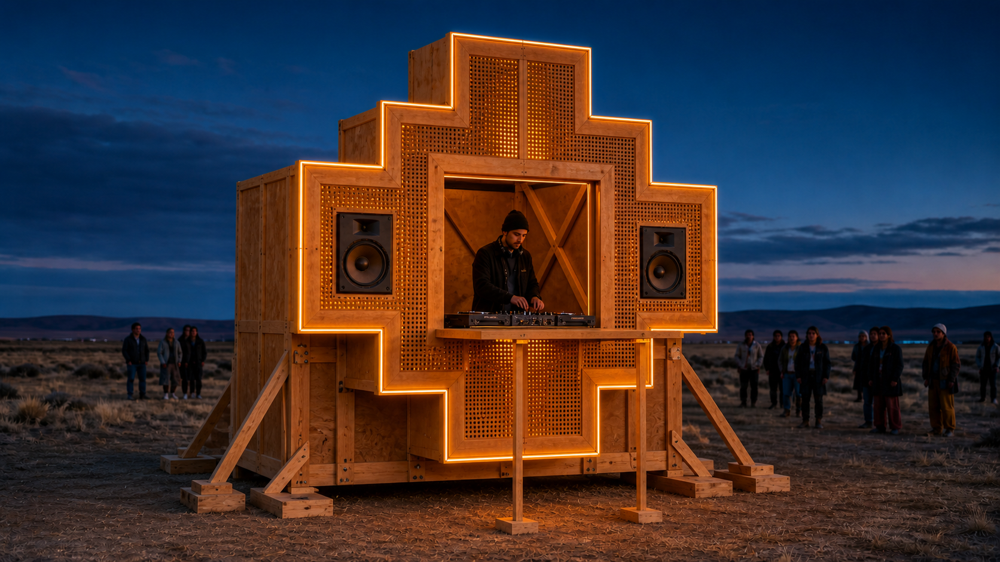

# Chakana

Proyecto en dos temporadas para desarrollar una instalación-fiesta con una única cara de chakana y un DJ de pie dentro del hueco central.



## Decisión vigente

### 2026: madera, estática y sin ruedas

Este año se construye una Chakana desmontable de madera, sin chasis, eje ni tracción. Sirve para aprender cuánto pesa realmente, cómo se transporta, cuánto tarda en montarse, cómo resiste el uso y cómo funciona el puesto DJ.

Presupuesto objetivo 2026: **USD 5.900**.

### 2027: móvil y metálica

El próximo año se conserva la geometría validada, se aligera en metal y se instala sobre una plataforma 2WD. El donor/eje se seleccionará con los datos de la temporada 2026.

El eje chino Hengna 60-72 V / 5 kW queda en el shortlist condicionado a RFQ. El chasis eléctrico de ómnibus de 12 m queda descartado por escala.

## Documentos vigentes en el root

- [Plan 2026/2027](PLAN_DE_PROYECTO.md)
- [Comparativa de movilidad 2027](COMPARATIVA_MOVILIDAD_2027.md)
- [Planos de madera 2026](PLANOS_MADERA_2026.pdf)
- [Presupuesto de madera 2026](PRESUPUESTO_MADERA_2026.csv)
- [Planos móviles preliminares 2027](PLANOS_MOVILIDAD_2027_REFERENCIA.pdf)
- [Presupuesto móvil de referencia 2027](PRESUPUESTO_MOVIL_REFERENCIA_15K.xlsx)

La presentación y el presupuesto móvil anteriores se conservan como referencia, no como alcance 2026:

- [Presentación de referencia móvil](PRESENTACION_REFERENCIA_15K.pdf)
- [Resumen ejecutivo móvil](RESUMEN_EJECUTIVO_REFERENCIA_15K.pdf)
- [Presentación editable](PRESENTACION_EDITABLE_REFERENCIA_15K.pptx)

## Chakana 2026

| Parámetro | Objetivo de prefactibilidad |
|---|---|
| Tipo | instalación temporal estática |
| Material | pino seco + fenólico exterior |
| Fachada | una sola cara escalonada |
| Altura | 2,4-2,6 m, a confirmar por estabilidad/sitio |
| Ancho | 1,8-1,95 m |
| Profundidad | 1,0-1,4 m según bases y arriostramiento |
| Hueco DJ | mínimo 1,2 × 1,1 m; ajustar con mockup 1:1 |
| Mesa | 1,2 × 0,55-0,65 m; altura 0,9-1,05 m |
| Módulos | 5-7, identificados y atornillados |
| Movimiento | ninguno; sin ruedas ni casters |
| Energía | LED 24 V; PA/red/generador externos |
| Uso exterior | condicionado a revisión de viento, bases y lastre |

## Plan resumido

| Fase | Entregable | Decisión |
|---|---|---|
| Requisitos/sitio | dimensiones, transporte y viento | sitio apto |
| Mockup DJ | hueco y mesa 1:1 | ergonomía aprobada |
| Módulo piloto | un escalón terminado | masa/rigidez/tiempo aceptables |
| Fabricación | módulos de madera | inspección de uniones |
| Montaje en seco | Chakana completa | estabilidad y secuencia aprobadas |
| Fiesta | PA, LED y mesa | cuatro horas sin falla |
| Evento piloto | bitácora real | backlog 2027 |
| Informe final | masa, tiempos y costos | habilita selección móvil |

El detalle está en el [plan del proyecto](docs/PLAN_DE_PROYECTO.md).

## Planos 2026

| Lámina | Contenido | Fuente editable |
|---|---|---|
| PM-001 | elevación, módulos y abertura DJ | [SVG](planos/PM-001_Chakana_Madera_Modulos.svg) |
| PM-002 | planta, bases, patas y arriostramiento | [SVG](planos/PM-002_Bases_Arriostramiento.svg) |
| PM-003 | unión repetible y secuencia de montaje | [SVG](planos/PM-003_Uniones_Montaje.svg) |

Son planos de prefactibilidad. La estructura, bases, lastre y anclaje al terreno deben ser revisados por un profesional competente para el sitio y viento de diseño antes del uso público.

## Presupuesto 2026

| Rubro | Base USD |
|---|---:|
| Madera y fenólico exterior | 1.350 |
| Herrajes y uniones | 500 |
| Bases, arriostramiento y lastre | 650 |
| Acabado/protección | 450 |
| Mesa DJ y cierre | 300 |
| LED 24 V | 350 |
| Primer alquiler PA/energía | 350 |
| Consumibles | 350 |
| Transporte y montaje | 450 |
| Revisión profesional/ensayos | 500 |
| Contingencia | 650 |
| **Total** | **5.900** |

## Movilidad 2027

La [comparativa técnica](docs/COMPARATIVA_MOVILIDAD_2027.md) estudia:

- donor eléctrico local completo;
- eje Hengna 60-72 V / 5 kW con discos hidráulicos;
- eje integrado Jujie 5 kW;
- familias Hengna de 7,5 kW;
- plataformas previamente evaluadas;
- chasis de ómnibus eléctrico de 12 m.

Conclusión actual: **donor local sigue siendo la referencia económica**, pero el eje Hengna merece RFQ para 2027. El chasis de ómnibus no pertenece a esta escala.

## Referencia Inti Huasi

La cuenta [@intihuasiorg](https://www.instagram.com/intihuasiorg/) fue aportada como referencia de espíritu y proceso de construcción comunitaria. El perfil público confirma el nombre y la descripción del colectivo, pero Instagram no permite auditar desde aquí publicaciones o detalles constructivos sin iniciar sesión. Por eso no se atribuyen dimensiones, especie de madera ni uniones específicas que no estén documentadas.

## Estructura del repositorio

```text
.
├── README.md
├── docs/        # plan y comparativa técnica
├── planos/      # SVG 2026 y referencia móvil 2027
├── output/      # PDF, planillas, presentaciones y visuales
├── build/       # generadores reproducibles
└── qa/          # renders de control
```

## Próximo paso

Confirmar el sitio y el vehículo de transporte disponible; hacer un mockup 1:1 del hueco DJ con listón/cartón; fabricar un único módulo de madera; pesarlo, montarlo tres veces y recién entonces comprar el resto del material.
