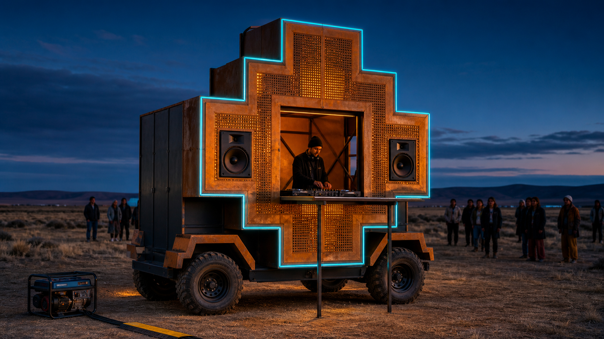

# Chakana Art Car

Anteproyecto de un art car pequeño para eventos tipo Burning Man y regionales: una **chakana sobre ruedas**, con una única fachada que se abre para que el DJ toque de pie con el vehículo detenido.



## Estado y decisión de diseño

Estado: `prefactibilidad v0.2` - agosto de 2026.

La solución base es deliberadamente simple:

- donor eléctrico local usado de 48 V;
- tracción 2WD mediante eje trasero motriz;
- velocidad operativa de 5-8 km/h y misión de hasta 5 km;
- ruedas ATV/UTV grandes de baja presión, sujetas a carga certificada;
- sólo un conductor sentado durante la marcha;
- sin pasajeros y sin los 500 kg útiles considerados inicialmente;
- DJ de pie dentro del hueco central de la única fachada, sólo estacionado;
- PA alquilado para los primeros eventos;
- generador de 5,5 kW continuos operando en tierra y fuera del vehículo;
- presupuesto base de USD 14.650, con techo duro de USD 15.000.

No se plantea como vehículo para vía pública. Los planos actuales son de prefactibilidad y deben revisarse después de elegir y medir el donor.

## Documentos vigentes

Estos enlaces en el root son la fuente de verdad de la última revisión:

- [Plan de proyecto detallado](PLAN_DE_PROYECTO.md)
- [Planos preliminares - PDF](PLANOS_PRELIMINARES.pdf)
- [Presupuesto editable y gates - XLSX](PRESUPUESTO_15K.xlsx)
- [Presentación técnica de la arquitectura mínima - PDF](PRESENTACION_REFERENCIA_15K.pdf)
- [Resumen ejecutivo de la arquitectura mínima - PDF](RESUMEN_EJECUTIVO_REFERENCIA_15K.pdf)
- [Presentación editable - PPTX](PRESENTACION_EDITABLE_REFERENCIA_15K.pptx)
- [Índice y criterios de los planos](planos/README.md)

La presentación conserva el estudio de arquitectura mínima y presupuesto, pero sus imágenes de Tatú son referencia histórica. Para la forma exterior vigente mandan este README y las láminas PL-001/002/003 de la Chakana. Los documentos anteriores de mayor escala permanecen en `output/` como archivo histórico.

## Concepto: Chakana de una sola cara

La fachada frontal es una cruz andina escalonada y luminosa. El volumen posterior es técnico, oscuro y discreto: aloja donor, piloto, energía y equipos guardados sin repetir la forma en la cara trasera.

En modo marcha:

- la abertura central está cerrada y trabada;
- la mesa, PA y cables están guardados;
- el generador está apagado;
- el DJ no viaja de pie;
- las ruedas siguen visibles sólo lo necesario para giro, refrigeración e inspección.

En modo fiesta:

- vehículo detenido, freno de estacionamiento y dos calzos;
- llave retirada y tracción inhibida;
- se abre el panel central;
- la mesa baja y apoya sobre dos patas nivelables independientes;
- el DJ queda de pie dentro del marco de la chakana;
- el generador se instala en tierra, separado y con cable protegido.

## Especificación de prefactibilidad

| Parámetro | Objetivo actual |
|---|---|
| Donor | carro de golf/utilitario eléctrico 48 V usado |
| Tracción | 2WD, eje trasero motriz, 3-5 kW nominales con buen pico |
| Velocidad | 5-8 km/h; 10 km/h tope |
| Autonomía de aceptación | 5 km cargado antes de comprar |
| Terreno | pasto, rastrojo, tierra firme y barro superficial |
| Fuera de envolvente | barro profundo, zanjas, pendiente húmeda fuerte y gran inclinación lateral |
| Ruedas iniciales | 25×10-12 atrás; 24×8-12 adelante; 8-10 psi iniciales |
| Ocupación en marcha | un piloto sentado |
| DJ | de pie en el suelo/piso bajo del puesto, sólo estacionado |
| PA | dos tops y un sub, inicialmente alquilados |
| Generador | 5,5 kW continuos; en tierra y fuera del vehículo |
| Envolvente artística | 3,6-4,0 m largo; 1,80-1,95 m ancho; altura a confirmar |
| Inversión base | USD 14.650 |

## Plan de proyecto resumido

| Fase | Resultado | Condición para avanzar |
|---|---|---|
| 0. Definición | alcance, roles, presupuesto y planos preliminares | sin pasajeros; DJ sólo detenido; techo congelado |
| 1. Donor | unidad seleccionada e inspeccionada | capacidad, frenos, dirección, batería y Tow/neutro verificados |
| 2. Rolling prototype | donor seguro con ruedas y recuperación | 5 km, freno, pendiente, giro y empuje aprobados |
| 3. Fiesta | generador, AC, PA alquilado y mesa DJ | cuatro horas, RCD e inhibición de tracción aprobados |
| 4. Chakana | fachada modular liviana de una cara | masa, visión, accesos y fijaciones aprobados |
| 5. Integración | vehículo completo | pesaje, iluminación, E-stop y checklist aprobados |
| 6. Evento piloto | operación real documentada | sin incidentes y correcciones cerradas |

El detalle de tareas, responsables, hitos, gates y ensayos está en el [plan de proyecto](docs/PLAN_DE_PROYECTO.md).

## Planos

| Lámina | Contenido | Fuente editable |
|---|---|---|
| PL-001 | envolvente general, lateral, frente y planta | [SVG](planos/PL-001_Envolvente_General.svg) |
| PL-002 | única fachada, abertura y ergonomía del DJ | [SVG](planos/PL-002_Fachada_DJ.svg) |
| PL-003 | interfaces, zonas prohibidas y levantamiento del donor | [SVG](planos/PL-003_Interfaces_Donor.svg) |

Las dimensiones marcadas `PROY` son objetivos. Batalla, trochas, masas, recorridos, offset, anclajes y altura final deben reemplazarse por cotas `AS-BUILT` después de comprar el donor.

## Presupuesto y reglas de corte

| Gate | Límite |
|---|---:|
| Donor + puesta a punto | USD 4.950 |
| Donor + rodaje/recuperación | USD 6.500 |
| Fiesta y seguridad eléctrica | USD 2.550 |
| Arte, fabricación y ensayos | USD 2.900 |
| Contingencia protegida | USD 1.300 |
| Total | USD 15.000 |

Para sostener el límite:

1. No comprar un donor por encima de USD 4.000.
2. Rechazar unidades que necesiten banco completo de baterías.
3. Alquilar PA durante los primeros eventos.
4. No importar chasis, baterías, generador ni eje completo en esta fase.
5. No construir la fachada antes de aprobar el rolling prototype.
6. No recortar frenos, E-stop, RCD, extinción ni ensayos.

## Próximo paso

Buscar tres donors locales comparables y completar para cada uno: modelo/serie, capacidad del fabricante, precio, estado de batería, prueba de 5 km, frenado, Tow/neutro, batalla, trochas y masa por eje. Recién entonces se actualizan los planos a revisión `AS-BUILT` y se congela la fachada.

## Estructura del repositorio

```text
.
├── README.md
├── docs/                  # plan y documentación de trabajo
├── planos/                # SVG editables y criterios de dibujo
├── output/                # entregables vigentes e históricos
│   ├── pdf/
│   ├── presentaciones/
│   └── visuals/
├── build/                 # generadores reproducibles
└── qa/                    # renders e inspecciones visuales
```

## Advertencia

Este material define una prefactibilidad. No reemplaza ingeniería de detalle, inspección estructural, cálculo de frenos/estabilidad, revisión de un electricista competente ni las reglas específicas del evento y del predio.
